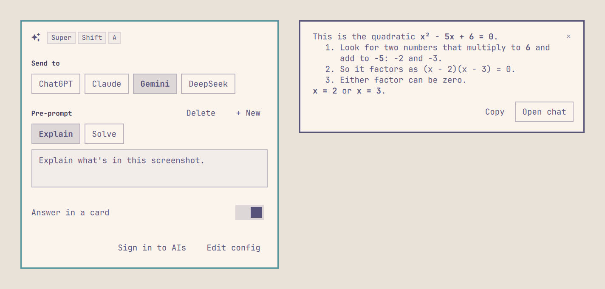

# Ask AI for Omarchy

Select part of your screen and ask ChatGPT, Claude, Gemini or DeepSeek about it. The answer appears in a small card over your screen; no browser tab opens.



- **Super + Shift + A**, then drag a region, click a window, or click empty space for the whole monitor.
- A hidden browser sends the capture to the AI you picked, with your pre-prompt ("Explain", "Solve", or your own).
- The answer streams into a card in the top-right corner. Copy it, or open the chat to keep going in your browser.
- A sparkles icon on the bar holds the choices: which AI, which pre-prompt, and the shortcut itself.

It uses the AIs' websites with your own accounts, not their APIs, so there are no API keys and no per-request costs.

## Install

```bash
omarchy plugin add https://github.com/skylightlim/omarchy-ask-ai.git --enable
~/.config/omarchy/plugins/skylightlim.ask-ai/bin/ask-ai-install
```

The second step puts `ask-ai` on your PATH, binds **Super + Shift + A** in `~/.config/hypr/bindings.lua`, installs [CloakBrowser](https://github.com/CloakHQ/CloakBrowser) for the hidden browser (unless you already have it), and lists anything else that's missing. It is safe to run again.

Super + Shift + A is Omarchy's ChatGPT web-app key; Ask AI takes it over. You can move it from the panel, and the web app gets its key back.

Then sign in: click the sparkles icon, **Sign in to AIs**, sign in to the AIs you use in the window that opens, and close it.

Needs `jq`, `wl-clipboard`, `socat`, `xorg-server-xvfb`, Python 3, and `omasnap` (or `slurp` and `grim`). `wtype` is only needed for browser mode.

## Remove

```bash
omarchy plugin remove skylightlim.ask-ai --yes
rm -f ~/.local/bin/ask-ai
rm -rf ~/.local/state/ask-ai
```

Then delete the lines Ask AI added to `~/.config/hypr/bindings.lua`: the `o.rebind("SUPER + SHIFT + A", "Ask AI about a screen region", "ask-ai")` line and the `ask-ai-record` submap block, each under an `-- Ask AI` comment. Install keeps a `bindings.lua.bak.<time>` copy from before it edited the file, and Omarchy's ChatGPT key comes back once the line is gone. CloakBrowser is left in place; remove it yourself if nothing else uses it.

## The panel

Click the sparkles icon on the bar. Right-click it to capture straight away.

- **The shortcut** is at the top. Click it, then press the new keys. If they already do something, the panel says what; press them again to take them over. Esc cancels.
- **Send to**: ChatGPT, Claude, Gemini or DeepSeek.
- **Pre-prompt**: pick one, or type your own. **+ New** starts a blank one, **Save** keeps your text in the list, **Delete** removes the selected one. Empty sends only the image.
- **Answer in a card**: on by default. Turn it off for browser mode.
- **Edit config** opens the config file, for adding AIs or editing pre-prompts in bulk.

Choices save as you make them.

| Key (panel open) | Does |
|---|---|
| Enter | Capture |
| ← / → | Previous / next AI |
| ↑ / ↓ | Previous / next pre-prompt |
| E | Edit the prompt text (Enter or Esc to finish) |
| C | Toggle answer in a card |
| Ctrl + S | Save your text as a pre-prompt (while editing) |
| Esc | Close |

## The answer card

The card shows the answer as it is written, formatted (headings, lists, code, maths as TeX). It never loads images or follows links from the answer on its own.

- **Copy** copies the whole answer; you can also select part of it.
- **Open chat** opens the conversation in your default browser.
- **Esc**, the **×**, or a swipe to the right closes it. The card has the keyboard when it appears, so Esc works straight away; click anywhere else to take the keyboard back.

## How the hidden browser works

Chat sites block headless browsers, so Ask AI runs [CloakBrowser](https://github.com/CloakHQ/CloakBrowser), a Chromium with fingerprint patches, as an ordinary browser window on a private, invisible X screen (Xvfb `:97`). In testing it reached all four sites both headless and this way, where Patchright and nodriver hit Cloudflare checks headless. It uses CloakBrowser's free build, which needs no licence key.

- It starts with your first capture (about 2 s), keeps a new chat ready for the AI you used last, and stops after 30 minutes idle.
- It has its own profile in `~/.local/share/ask-ai/profile`, apart from your own browsers, with a fixed fingerprint so the sites see the same browser each time.
- It attaches the image the way a paste does, waits for the upload to finish, types the pre-prompt, sends, and reads the reply back as Markdown.
- How each site is driven lives in `browser/sites.py`. Sites change their pages; when a step stops working, the card says which.

Some sites ask for something once before the first image (Gemini's notice about the rights to uploaded images, Claude's first-run setup). Use **Sign in to AIs** to deal with those in a visible window.

**Mind the terms.** Automating these websites is against their terms of service. Use it with your own accounts, at your own risk.

## Browser mode

With **Answer in a card** off, Ask AI opens the chat in your default browser instead and pastes the capture and pre-prompt there. Two more switches appear:

- **Send automatically** presses Enter once the image has uploaded.
- **Open in scratchpad** opens the chat on Omarchy's scratchpad (Super + S) so it slides over what you're doing; later sends reuse that window.

It watches the browser window to paste only once the page is ready, checks that the image attached, and only ever types into that browser window.

## Configure

`~/.config/ask-ai/config.json` is created on first use:

```json
{
  "targets": [
    { "name": "ChatGPT", "url": "https://chatgpt.com/", "match": "ChatGPT" }
  ],
  "prompts": [
    { "name": "Explain", "text": "Explain what's in this screenshot." }
  ],
  "loadTimeout": 10,
  "submitDelay": 0.2
}
```

- `targets`: the AIs. `match` is a case-insensitive regex the chat tab's title must contain. A site needs an entry in `browser/sites.py` to work in the card.
- `loadTimeout`: seconds to wait for a new chat page (browser mode).
- `submitDelay`: least seconds before pressing Enter (browser mode).

`ask-ai region`, `ask-ai windows` and `ask-ai fullscreen` start the capture in that mode.

## Troubleshooting

- **The card says a site didn't take the image or didn't answer**: the site may want something first. Open **Sign in to AIs** and look at that tab.
- **Logs**: `~/.local/share/ask-ai/askd.log` (hidden browser), `$XDG_RUNTIME_DIR/ask-ai/send.log` (browser mode, timestamped).
- **No shortcuts work**: the panel was recording a shortcut and didn't finish. Press Super + Escape.
- **After editing the QML**: run `omarchy restart shell`.

## License

MIT
